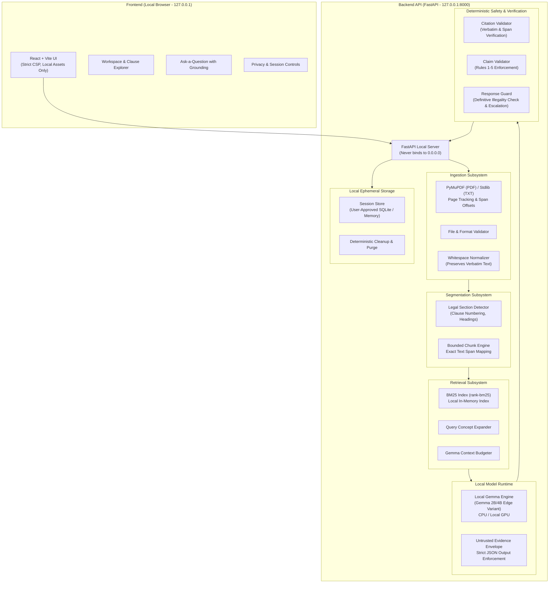

# Architecture Specification: Private Legal Triage

## 1. System Philosophy and Boundaries

Private Legal Triage is a local-first, evidence-grounded legal document triage system designed specifically for rental agreements (PDF and TXT). It is strictly **not** a general legal chatbot.

### Core Architectural Axioms
1. **Zero External Communication**: All inference, extraction, tokenization, search, retrieval, and storage execute exclusively on the user's local machine (`127.0.0.1`). No cloud LLMs, no remote embedding endpoints, no cloud OCR, and no telemetry.
2. **Untrusted Evidence Boundary**: All uploaded document text is treated strictly as **untrusted data**, isolated in sanitized evidence blocks to prevent indirect prompt injection.
3. **Deterministic Verification over Generation**: Language model outputs are never trusted unconditionally. Every finding, citation, and quote is deterministically verified against the original document text before presentation.
4. **Strict Source Separation**: Document sources are classified into three immutable categories at ingestion (`contract`, `legislation`, `court_judgment`). External legal sources are never conflated with the uploaded contract.
5. **No Hallucinated Sufficiency**: When retrieved evidence does not clear relevance thresholds or when a clause is omitted from the contract, the system explicitly reports insufficient information rather than extrapolating.

---

## 2. High-Level System Architecture



---

## 3. Subsystem Breakdown

### 3.1 Ingestion Subsystem (`backend/app/ingestion/`)
- **`validator.py`**: Verifies magic bytes, file extensions (`.pdf`, `.txt`), file size (capped at 15 MB), encryption flags, and rejects scanned/image-only PDFs lacking local text layer.
- **`pdf_parser.py`**: Utilizes PyMuPDF (`fitz`) to extract text per page while tracking exact character offsets and page numbers. Preserves tables, headings, and clause numbering.
- **`txt_parser.py`**: Standard library UTF-8 parser with line and synthetic page boundary tracking.
- **`normalizer.py`**: Normalizes excessive whitespace for tokenizer stability while preserving an exact verbatim `full_text` buffer for character span verification.

### 3.2 Segmentation Subsystem (`backend/app/document/`)
- **`section_detector.py`**: Identifies legal hierarchy:
  - Clause numbering (e.g., `1.`, `1.1`, `Section 2`, `Clause IV`)
  - Headings (e.g., `SECURITY DEPOSIT`, `TERMINATION AND NOTICE`)
  - Subclauses and enumerated lists
- **`chunker.py`**:
  - Respects legal structure: never merges unrelated clauses into one evidence passage.
  - Generates chunks bounded by legal sections. If an individual section exceeds 1,200 characters, it is cleanly split with overlap without severing atomic sentences.
  - **Invariance Rule**: Every `Chunk` contains `start_char` and `end_char`. The test `full_text[start_char:end_char] == chunk.text` must hold true for 100% of generated chunks.

### 3.3 Retrieval Subsystem (`backend/app/retrieval/`)
- **`index.py`**: In-memory BM25 index built dynamically upon document ingestion. No cloud vector databases, no remote embeddings.
- **`search.py`**:
  - Domain concept expansion: maps tenant queries (e.g., "moving out early") to contract terminology (`termination`, `notice period`, `break clause`, `forfeiture`).
  - Pre-generation thresholding: if no retrieved chunk clears the minimum BM25 relevance score, the retrieval stage aborts immediately with an `insufficient_evidence` response, preventing LLM hallucination.
- **`ranker.py`**: Context budget management. Selects top-k candidates up to a tight character budget (e.g., 4,000 characters) to optimize Gemma's local inference speed and context window.

### 3.4 Local Model Runtime (`backend/app/agent/`)
- **`gemma_runtime.py`**: Manages local edge model loading and execution. Model weights are stored locally in `./models/`. Never makes remote API requests.
- **`prompts.py`**: Formats the prompt using an isolated untrusted evidence envelope:
  ```
  [SYSTEM CONSTRAINTS]
  You are an evidence-grounded legal triage assistant.
  Extract facts exclusively from the untrusted document passages below.
  Do not extrapolate or assume unstated terms.

  === BEGIN UNTRUSTED DOCUMENT PASSAGES ===
  Passage ID: p_1 (Page 2)
  ...
  === END UNTRUSTED DOCUMENT PASSAGES ===
  ```
- **`analyzer.py`**: Drives contract overview generation and ad-hoc Q&A workflows, producing structured JSON outputs.

### 3.5 Deterministic Safety & Guardrails (`backend/app/safety/`)
- **`citation_validator.py`**: Validates every citation:
  1. Checks that cited `evidence_id` exists in the retrieval candidate set.
  2. Verifies that `exact_quote` exists verbatim in `full_text` at `start_char:end_char`.
- **`claim_validator.py`**: Enforces the 6 Core Deterministic Rules:
  1. Explicit statement $\implies$ must have verified evidence passage.
  2. Interpretation $\implies$ must be marked `is_interpretation = True`.
  3. Missing clause $\implies$ must have `exists_in_document = False` and no evidence.
  4. Legal concern $\implies$ banned from stating definitive illegality (`is illegal`, `is void`).
  5. Source separation $\implies$ contract evidence must have `source_type == SourceType.CONTRACT`.
  6. Insufficient evidence $\implies$ response must detail what could not be established.
- **`response_guard.py`**: Intercepts requests for definitive legal judgments (e.g., "Can I break this lease without penalty?", "Is this clause legally enforceable?") and automatically injects mandatory professional legal escalation.

### 3.6 Local Storage & Lifecycle (`backend/app/storage/`)
- **`session_store.py`**: Ephemeral in-memory dictionary or optional user-approved local SQLite database.
- **`cleanup.py`**: Full session purge endpoint. Explicit user action immediately zeroes memory and removes any temporary files from disk.

---

## 4. Frontend Architecture (`frontend/`)

- Built with **React 18 + TypeScript + Vite**.
- **No external CDN assets**: all fonts, icons (Lucide SVG), and scripts are bundled locally.
- **Content Security Policy (CSP)**:
  `default-src 'self'; script-src 'self'; style-src 'self' 'unsafe-inline'; connect-src 'self' http://127.0.0.1:8000; img-src 'self' data:; object-src 'none'; frame-ancestors 'none';`
- Interactive visual distinction:
  - **Direct Quotes**: Highlighted verbatim with page pill and click-to-verify.
  - **Interpretations**: Distinct visual badge ("Interpretation / Implied").
  - **Potential Concerns**: Amber/Red caution callouts with legal escalation notices.
  - **Insufficient Evidence**: Explicit grey banner explaining missing contract terms.
